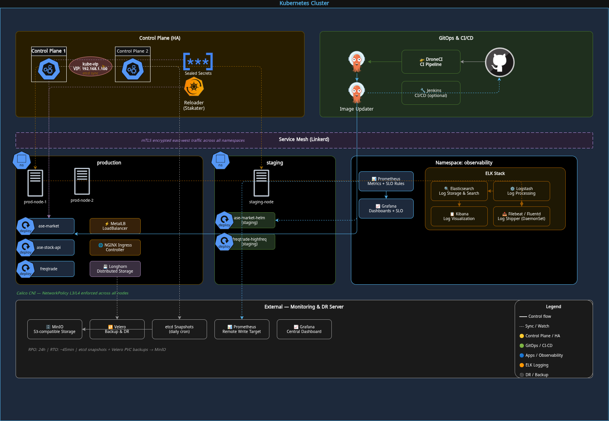

# Kubernetes Homelab

A self-hosted Kubernetes cluster used to document and share my homelab learning
journey — bootstrap, storage, networking, service mesh, observability, and
access control.

For step-by-step operational procedures (bootstrap order, backups, upgrades,
troubleshooting), see [RUNBOOK.md](RUNBOOK.md).

## Architecture

Editable source: [architecture/cluster-diagram.drawio](architecture/cluster-diagram.drawio) (open in draw.io / diagrams.net). Both files are generated by `python3 architecture/gen_diagram.py architecture/cluster-diagram.drawio <out.svg>` + `rsvg-convert -z 1.25 <out.svg> -o architecture/cluster-diagram.png`.

## Cluster Topology

| Node | Role | IP |
|---|---|---|
| tf-control-plane-01 | `control_plane` | 192.168.0.3 |
| tf-control-plane-02 | `control_plane` | 192.168.0.4 |
| tf-worker-01 | `workers` | 192.168.0.10 |
| tf-worker-02 | `workers` | 192.168.0.11 |
| kube-vip VIP | control-plane endpoint | 192.168.0.19 |

VMs are created by [terraform/](terraform/); inventory groups are in `ansible/proxmox-k8s-cluster-hosts.ini`.

## Software Stack

| Layer | Component | Notes |
|---|---|---|
| Provisioning | Packer + Terraform + Ansible | VMs and images via `packer/` and `terraform/`; kubeadm bootstrap via `ansible/` — see [ansible/README.md](ansible/README.md) |
| Container runtime | containerd | |
| CNI | Calico | Migrated from Flannel |
| CSI / Storage | Longhorn | Requires `cryptsetup`, `open-iscsi`, NFSv4 |
| Ingress | NGINX Ingress Controller | L7 routing + TLS termination |
| Load balancer | MetalLB | Pool and L2 advertisement in `terraform/k8s-addons/metallb.tf` |
| Service mesh | Istio | Gateway + peer authentication for `ase-market` (`istio/`) |
| Observability | Prometheus, Grafana, Node Exporter | |
| Remote access | Teleport | In-cluster agent via Helm (`teleport/`) dials out to the self-hosted control plane on `192.168.0.158` (`external-services/192.168.0.158.md`) |
| RBAC | Custom roles/bindings | `RBAC/` |
| TLS certificates | cert-manager | Automated Let's Encrypt issuance/renewal via Cloudflare DNS-01 (`cert-manager/`, `terraform/k8s-addons/cert-manager.tf`); Cloudflare API token synced from LocalStack Secrets Manager, never stored in git |

## Workloads

- **ase-market** — sample microservice deployed via Helm (`helm/ase-market/`), fronted by the Istio gateway
- **freqtrade** — algorithmic trading bot deployments (`freqtrade/`)

## Standalone Hosts

Not everything runs in the cluster. `192.168.0.158` is a separate box
running Docker Compose stacks (pihole, monitoring) *and* it's the
self-hosted Teleport control plane that `teleport.homebytes.space`
actually resolves to — see
[external-services/README.md](external-services/README.md).

## Prerequisites

- Ansible installed on the control machine
- SSH access to all target nodes, with passwordless sudo
- Inventory configured at `ansible/proxmox-k8s-cluster-hosts.ini` (control_plane/workers)
- Internet access from nodes (or a local mirror/registry)

## Key Design Decisions

| Decision | Rationale |
|---|---|
| Ingress over per-Service LoadBalancer | LoadBalancer operates at L4 (TCP/UDP); NGINX Ingress operates at L7, enabling host- and path-based routing plus TLS termination from a single entry point |
| Calico (migrated from Flannel) | Deployed by `terraform/k8s-addons/calico.tf` |
| Longhorn for storage | _TODO: document rationale_ |

## Further Reading

- [RUNBOOK.md](RUNBOOK.md) — bootstrap order, day-2 operations, backups, incident playbooks
- [ansible/README.md](ansible/README.md) — full playbook inventory and configuration layout (`group_vars`, `host_vars`, `ansible.cfg`)
- [RBAC/README.md](RBAC/README.md) — per-user kubeconfig / RBAC setup
- [external-services/README.md](external-services/README.md) — standalone (non-cluster) hosts and their Docker Compose stacks
